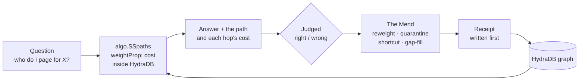

<div align="center">

# TrailMend

### The graph that repairs its own relationships.

**Your service catalogue is quietly wrong. TrailMend finds out from its own answers and fixes it, with a receipt for every change.**

[**Live app**](https://trail-mend.vercel.app) · [**API**](https://trailmend-production-ee2e07ff.up.railway.app/v1/ready) · [**For judges**](JUDGING.md) · [**Benchmark**](BENCHMARK.md) · [**Go-to-market**](https://trail-mend.vercel.app/go-to-market)

Built on [HydraDB OSS 0.4](https://github.com/hydra-db/hydradb) · HydraDB hackathon, Track 1: self-improving graph

</div>

---

## The problem

Every company past a few dozen services keeps a map of who owns what: a service catalogue, an on-call rota, a
Backstage entry, a wiki page. **It is wrong in ways nobody can see.** A service still points at a team that handed it
over last quarter. A rota entry is stale. Two records describe the same person. Nobody notices until an incident,
when the page goes to the wrong human and the clock keeps running while someone works out who actually owns it.

The map is edited by hand, so it decays between audits. And it ignores the one signal that is always there:
**whether the answer it just gave was right.**

## What TrailMend does

TrailMend answers *"who owns this?"* and *"who do I page?"* as a **weighted path search inside HydraDB**, shows the
path it walked, and learns from every answer that is judged.

| When an answer is… | TrailMend… |
|---|---|
| **right** | makes every link on its path a little cheaper to walk |
| **wrong** | makes the links that led there dearer, and after repeated blame **quarantines** the link into a type search cannot traverse |
| **confirmed again and again** | **compresses** the path into a shortcut edge |
| **unreachable** | reads withheld documents that mention the entity and **gap-fills** the missing link |

**Every change writes a receipt before it touches the graph**, with the cost before and after and the questions that
caused it, and any receipt can be rolled back. **No LLM is on the answer path, and no LLM scores an answer.**



## The results

<!-- headline:start -->
| result | before | after learning | against |
|---|---|---|---|
| Company graphs, clean replication: held-out accuracy | 77.0% | **84.6%** | frozen graph 77.0%; beats it significantly on 3 of 3 seeds |
| Company graphs, run 4 learner: held-out accuracy | 83.3% | **89.7%** | frozen graph 83.3%; refuses 1.3%; preregistered 3 of 3 pass |
| Company graphs, run 4 learner: wrong answers | 7.3% | **2.8%** | frozen graph 7.3% |
| MetaQA (public, half the triples withheld): Hits@1 | 55.3% | **71.5%** | frozen graph 55.3%, random reweighting 55.6%; beats frozen significantly on 3 of 3 seeds |
| Same questions, document store with no graph | 28.3% | **28.3%** | flat: no links for the loop to repair |
| Held-out answers right at the start, still right at the end (run 2 and MetaQA) | — | **1,386 of 1,393** | 7 of 7 breaks traced to a receipt |
<!-- headline:end -->

Every number in that table is written by `trailmend.eval.report` from the files in [`evidence/`](evidence/), never
typed by hand. The company graphs are **generated** so every planted fault and its truth is known; MetaQA is
**public**. All results are on **held-out** questions the Mend never saw, against controls that make the same number
and size of changes at random.

**We publish what failed, too.** Run 1's headline hypothesis failed, run 3's abstention variant failed two of its
safeguards, and two of run 2's eight hypotheses missed their thresholds. Each stays published with the rule it was
decided by. The full story, every table and every file's sha256 are in **[BENCHMARK.md](BENCHMARK.md)**.

## Try it in two minutes

1. Open [**/ask**](https://trail-mend.vercel.app/ask) and ask **"Who is on call for the Delta team?"** It answers
   *Selin Tadesse*, over a link three documents support. The truth is *Bao Maeda*, asserted by only one document.
2. Press **wrong**. The link on the path gets dearer and you get a receipt id. Do it twice more: the link is
   **quarantined** and the answer becomes *Bao Maeda*.
3. Open [**/truth**](https://trail-mend.vercel.app/truth): the Delta on-call fault has moved from *still wrong* to
   *quarantined*, with the receipts that moved it.
4. Open [**/mend**](https://trail-mend.vercel.app/mend) and **roll back** any receipt. The rollback writes its own
   receipt.

The demo graph is shared, so if someone judged it before you, the answer may already be *Bao Maeda*. The costs on the
page show which state it is in. **[JUDGING.md](JUDGING.md)** has a ten-minute review path and a list of ways to
try to break it.

## Why HydraDB

The repair only works because the answer *is* a graph query. HydraDB OSS 0.4 is the only store on the answer path,
run unmodified as a separate service.

- **Answering** is `algo.SSpaths` over the relationship types a question allows, with `weightProp: 'cost'` and
  `maxLen` 3. Change a cost and the answer changes.
- **Learning** lives on the edges: `cost`, `confirms`, `blames` and a `recent` window of judgements are relationship
  properties, so blame survives a round and a restart.
- **Quarantine** moves an edge to a mirror type `Q_<TYPE>`. The query builder refuses to search a `Q_` type, so a
  quarantined edge cannot come back through a code path that forgot about it.
- **Shortcuts** are `SC_<TEMPLATE>` edges that carry the path they compress, and are retired when any hop on it is
  quarantined.

HydraDB 0.4 behaviour that we had to verify live before relying on it is recorded in
[docs/REALITY_SPIKES.md](docs/REALITY_SPIKES.md).

## Who it is for

| Who | Why they care |
|---|---|
| **Platform and SRE leads** *(the first buyer)* | They own the rota and the catalogue, and they get paged when an alert goes to a team that no longer owns the service. |
| **On-call engineers and incident commanders** | They ask "who owns this?" at 3 a.m., and every wrong answer costs minutes of a live incident. |
| **IT and service-desk owners** | Routing a ticket is the same question on a different graph. |
| **Security and compliance** | "Who owns this asset?" has to be right during an audit, and every change has to be explainable afterwards. |

**Why they would pay:** fewer pages to the wrong person, a catalogue that maintains itself from use instead of from
audits, every change auditable and reversible, and no model guessing at the answer. Success is one number agreed up
front: the share of ownership questions answered correctly on a held-out set the team writes, before and after. That
is the same test every result here was measured with. More on
[/go-to-market](https://trail-mend.vercel.app/go-to-market).

## Run it locally

Needs [uv](https://docs.astral.sh/uv/), Node 20+ and Docker.

```bash
cp .env.example .env    # set TRAILMEND_HYDRA_TOKEN and TRAILMEND_ADMIN_TOKEN
uv sync --frozen
make gate               # ruff, pyright strict, unit tests, web typecheck, lint and build
make hydra-up           # an S3 stand-in, then the pinned HydraDB image
make verify             # live contract tests against the real HydraDB
make api                # the product API on :8000
```

The site, in a second terminal:

```bash
make web-install
cd apps/web
TRAILMEND_API=http://localhost:8000 TRAILMEND_ADMIN_TOKEN=<same token> npm run dev   # http://localhost:3000
```

`make hydra-down` stops HydraDB when you are done. Without Docker, build `graph-node` from the HydraDB repo and run it against any S3-compatible endpoint; see
[docs/REALITY_SPIKES.md](docs/REALITY_SPIKES.md) S1, S10 and S12. Every experiment's rerun command is in
[BENCHMARK.md](BENCHMARK.md#reproduce-it).

## How it is built

```
src/trailmend/core/    the pure Mend: credit, bounded update, quarantine, promotion, receipts, rollback
src/trailmend/graph/   the only place a Cypher string exists: client, schema, loader, reset
src/trailmend/search/  seeding a question to an entity, and turning paths into an answer
src/trailmend/loop/    one round: judge, credit, plan, apply, promote, gap-fill, journal
src/trailmend/eval/    splits, arms, runs, and every evidence file
src/trailmend/api/     the product API (FastAPI)
apps/web/              the site (Next.js), server components calling that API
```

- `core/` does no I/O, reads no clock and uses no global randomness. Its rules are property-tested.
- Held-out questions are made only by `eval/splits.py`. The round runner takes a `TrainQuestion`, so handing it a
  held-out question is a type error.
- Python is checked with pyright strict and ruff, and the web app with tsc and eslint. `make gate` runs before every
  push.

## Documentation

| | |
|---|---|
| [JUDGING.md](JUDGING.md) | where to look, how to check every claim, and how to try to break it |
| [BENCHMARK.md](BENCHMARK.md) | every run, hypothesis, verdict and evidence file, failures included |
| [docs/PRD.md](docs/PRD.md) | the plan, with each run's preregistration |
| [DECISIONS.md](DECISIONS.md) | every design decision, dated, with the reason |
| [docs/RUN1_DIAGNOSIS.md](docs/RUN1_DIAGNOSIS.md) | why run 1 failed, measured on training data only |
| [docs/REALITY_SPIKES.md](docs/REALITY_SPIKES.md) | HydraDB 0.4 facts verified live |
| [ROADMAP.md](ROADMAP.md) | what is deliberately not built |

## Attribution and licence

MetaQA is from Zhang et al., *Variational Reasoning for Question Answering with Knowledge Graph*, AAAI 2018
([github.com/yuyuz/MetaQA](https://github.com/yuyuz/MetaQA)), CC licence. Its files are not redistributed:
[`data/external/metaqa.manifest.json`](data/external/metaqa.manifest.json) pins each file's sha256. The half-KG setting
follows `MetaQA_half` in Saxena et al., *EmbedKGQA*, ACL 2020, redrawn for each seed.

HydraDB is AGPL-3.0 and runs as a separate, unmodified service, pulled by digest. TrailMend's own code is Apache-2.0.
[SelfGraph](docs/SELFGRAPH.md) was evaluated and is **not** on the answer path.
